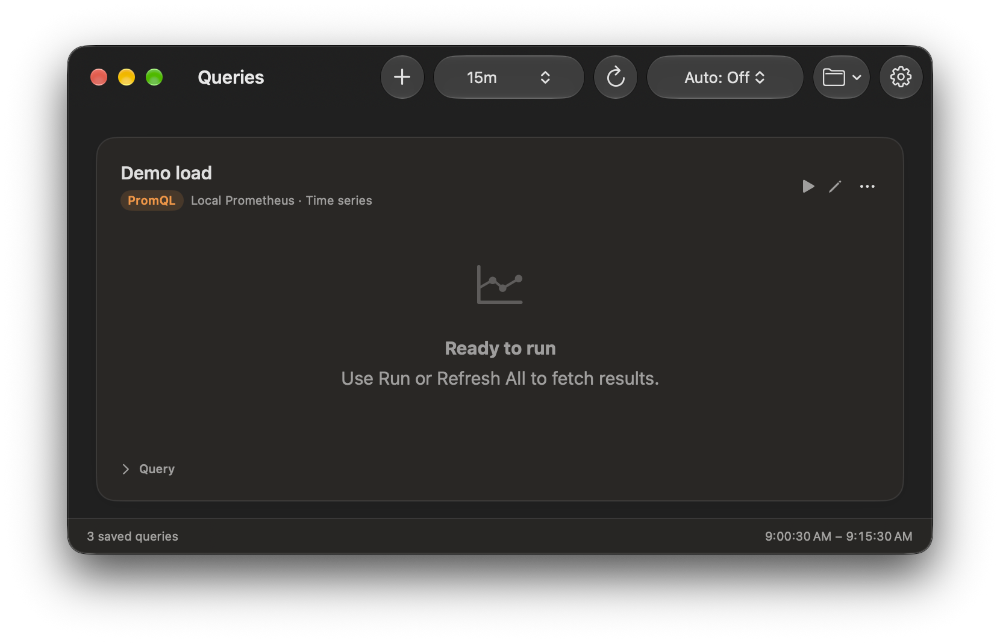

# Queries

Your queries, together.

Keep reusable PromQL and LogQL queries in a native macOS stack. Refresh them together, follow smooth charts, and inspect logs without building a dashboard.

- Smooth charts that connect across missing samples.
- Shared time ranges, independent refreshes, and copyable query text.
- Save, reorder, duplicate, import, and export your collection.

Requires macOS 27.2 or later, with [gcx](https://github.com/grafana/gcx) installed and authenticated.
